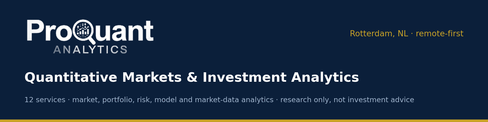

# ProQuant Analytics

**Quantitative markets and investment analytics** · Rotterdam, Netherlands · remote-first

Evidence-led research and measurement for investment teams, asset managers, advisers and fintechs: market and company research, strategy testing, portfolio construction, risk, execution costs, performance reporting, model validation, derivatives, and market-data workflows.

All work is research and measurement, not investment advice. Public case-study pages use public sources or clearly labelled hypothetical inputs; they are not client engagements or investment recommendations. Client information is kept private.

[Website](https://www.proquant-analytics.com) · [Contact](mailto:info@proquantanalytics.com)

## Current service catalogue

The private delivery framework contains 12 connected services. Private templates, operating manuals, intake materials, prompts and source code remain private. The public gallery reports each service's source and validation status; it does not claim twelve completed real-data reports yet.

| # | Service | Public study status |
|---|---|---|
| 01 | **Market & Macro Monitor** | [Study](https://github.com/AbduWars/proquant-analytics-case-studies/blob/main/studies/01.md) — Treasury source identified; calculations pending |
| 02 | **Quantitative Company Analysis** | [Study](https://github.com/AbduWars/proquant-analytics-case-studies/blob/main/studies/02.md) — SEC source identified; clean exhibits pending |
| 03 | **Strategy Research & Backtesting** | [Study](https://github.com/AbduWars/proquant-analytics-case-studies/blob/main/studies/03.md) — method demonstrator; no performance claim |
| 04 | **Portfolio Construction & Allocation** | [Study](https://github.com/AbduWars/proquant-analytics-case-studies/blob/main/studies/04.md) — numerical results pending |
| 05 | **Positions, Leverage & Carry** | [Study](https://github.com/AbduWars/proquant-analytics-case-studies/blob/main/studies/05.md) — CFTC aggregate source identified |
| 06 | **Portfolio Risk & What-if Analysis** | [Study](https://github.com/AbduWars/proquant-analytics-case-studies/blob/main/studies/06.md) — public rates; hypothetical book only |
| 07 | **Execution Costs & Slippage** | [Study](https://github.com/AbduWars/proquant-analytics-case-studies/blob/main/studies/07.md) — no compatible public order-level dataset verified |
| 08 | **Performance & Investor Reporting** | [Study](https://github.com/AbduWars/proquant-analytics-case-studies/blob/main/studies/08.md) — no real-fund performance data used |
| 09 | **Model Validation** | [Study](https://github.com/AbduWars/proquant-analytics-case-studies/blob/main/studies/09.md) — protocol documented; measured results pending |
| 10 | **Derivatives & Pricing** | [Study](https://github.com/AbduWars/proquant-analytics-case-studies/blob/main/studies/10.md) — hypothetical option inputs only |
| 11 | **Market Data Platform & Reconciliation** | [Study](https://github.com/AbduWars/proquant-analytics-case-studies/blob/main/studies/11.md) — SEC API workflow; no raw data mirrored |
| 12 | **AI-assisted Quantitative Research** | [Study](https://github.com/AbduWars/proquant-analytics-case-studies/blob/main/studies/12.md) — evidence workflow; human review required |

**Browse:** [Public gallery](https://AbduWars.github.io/proquant-analytics-case-studies/) · [Repository and source notes](https://github.com/AbduWars/proquant-analytics-case-studies). Each study states its limits; none represents a client engagement.

## Client delivery

Depending on scope and source data, a client pack can include an offline start page, decision summary, evidence report, editable presentation, Excel workbook, interactive HTML dashboard, methodology and assumptions, handover note, and supporting data exports. Deliverables are checked against the agreed project scope before delivery.

## Privacy and scope

The 12 current services above are the complete public catalogue. Earlier demonstrations are archived and intentionally not linked here. No client files, names, credentials, private templates, prompts or operating manuals are published.

---

<b>ProQuant Analytics</b> · <a href="https://www.proquant-analytics.com">proquant-analytics.com</a> · <a href="mailto:info@proquantanalytics.com">info@proquantanalytics.com</a>

