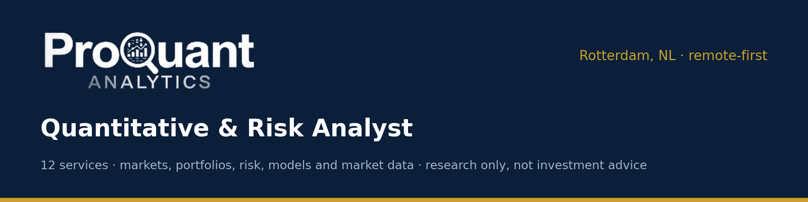

# ProQuant Analytics

**Quantitative & Risk Analyst** · ProQuant Analytics · Rotterdam, Netherlands · remote-first

Evidence-led research and measurement for investment teams, asset managers, advisers and fintechs: market and company research, strategy testing, portfolio construction, risk, execution costs, performance reporting, model validation, derivatives, and market-data workflows.

All work is research and measurement, not investment advice. Public case-study pages use public sources or clearly labelled hypothetical inputs; they are not client engagements or investment recommendations. Client information is kept private.

[Website](https://www.proquant-analytics.com) · [Contact](mailto:info@proquantanalytics.com)

## Portfolio: 12 case studies on public data

Each study starts with a question an investment team asks and ends with six deliverables from one run: report, one-page summary, presentation, Excel workbook with live formulas, methodology and interactive dashboard. Click a cover to open it.

**[Open the gallery](https://abduwars.github.io/proquant-analytics-case-studies/)** · [Repository](https://github.com/AbduWars/proquant-analytics-case-studies) · [Data sources and rights](https://abduwars.github.io/proquant-analytics-case-studies/DATA_SOURCES.md)

<table>
<tr><td align="center" width="33%"> <b>01 · Market &amp; Macro Monitor</b></td><td align="center" width="33%"> <b>02 · Quantitative Company Analysis</b></td><td align="center" width="33%"> <b>03 · Strategy Validation</b></td></tr>
<tr><td align="center" width="33%"> <b>04 · Portfolio Construction</b></td><td align="center" width="33%"> <b>05 · Positions, Leverage &amp; Margin</b></td><td align="center" width="33%"> <b>06 · Portfolio Risk &amp; What-if</b></td></tr>
<tr><td align="center" width="33%"> <b>07 · Execution Costs</b></td><td align="center" width="33%"> <b>08 · Performance &amp; Investor Reporting</b></td><td align="center" width="33%"> <b>09 · Model Validation</b></td></tr>
<tr><td align="center" width="33%"> <b>10 · Options: Pricing &amp; Hedging</b></td><td align="center" width="33%"> <b>11 · Market Data Platform</b></td><td align="center" width="33%"> <b>12 · AI-Assisted Research, Checked</b></td></tr>
</table>

## The answers in one line

| # | Service and case study | Result |
|---|---|---|
| 01 | [**Market & Macro Monitor**](https://abduwars.github.io/proquant-analytics-case-studies/projects/01-market-monitor/) | Two instruments of 12 are outside their own limits; one more is close. |
| 02 | [**Quantitative Company Analysis**](https://abduwars.github.io/proquant-analytics-case-studies/projects/02-company-analysis/) | NVIDIA leads on growth and on margin; five points in the reports deserve a question. |
| 03 | [**Strategy Validation**](https://abduwars.github.io/proquant-analytics-case-studies/projects/03-strategy-validation/) | Not validated: seven tests failed; it earned -0.9% a year against +2.7%. |
| 04 | [**Portfolio Construction**](https://abduwars.github.io/proquant-analytics-case-studies/projects/04-portfolio-construction/) | Equal weight earned the most for its risk on unseen data, but no method is clearly better than equal weights. |
| 05 | [**Positions, Leverage & Margin**](https://abduwars.github.io/proquant-analytics-case-studies/projects/05-positions-leverage/) | Two rules of 7 are broken; none of the past shocks would end in a margin call. |
| 06 | [**Portfolio Risk & What-if**](https://abduwars.github.io/proquant-analytics-case-studies/projects/06-portfolio-risk/) | One limit of 9 is broken, two more are close. |
| 07 | [**Execution Costs**](https://abduwars.github.io/proquant-analytics-case-studies/projects/07-execution-costs/) | Trading cost 22.4 bp; Gamma Capital and Delta Direct differ. |
| 08 | [**Performance & Investor Reporting**](https://abduwars.github.io/proquant-analytics-case-studies/projects/08-performance-reporting/) | +8.7% year to date after fees, -1.7 points against the benchmark; three months to settle with the administrator. |
| 09 | [**Model Validation**](https://abduwars.github.io/proquant-analytics-case-studies/projects/09-model-validation/) | Not fit for use as documented: three high-severity findings. |
| 10 | [**Options: Pricing & Hedging**](https://abduwars.github.io/proquant-analytics-case-studies/projects/10-derivatives-pricing/) | The pricer is right; the risk is the volatility: 50% of hedged sales on real prices lost money. |
| 11 | [**Market Data Platform**](https://abduwars.github.io/proquant-analytics-case-studies/projects/11-data-platform/) | The data are right and the platform repeats itself; three actions remain before it runs alone. |
| 12 | [**AI-Assisted Research, Checked**](https://abduwars.github.io/proquant-analytics-case-studies/projects/12-ai-research/) | Every drafted sentence has a source; the checker rejects 79.6% of planted errors, so a person still signs. |

Public data: the Federal Reserve, the US Treasury, the US Energy Information Administration, the SEC, the CFTC and Cboe BZX. Nobody commissioned these studies and no client data are used; where holdings, orders or files are hypothetical or constructed, the study says so.

## Combined projects (2–3 services)

| Project | Services | The client's question |
|---|---|---|
| **Strategy from hypothesis to risk** | 03 Strategy → 07 Execution costs → 06 Risk | Does the rule survive real trading costs, and does it stay within our risk limits? |
| **Portfolio: allocation, risk and performance** | 04 Allocation → 06 Risk → 08 Performance | What are the weights, exposures and risks, and how do we explain the period's performance? |
| **Company analysis in market context** | 01 Market monitor → 02 Company analysis → 09 Validation | What do the company and market data say, and is the method defensible? |
| **Operational market data** | 11 Data platform → 01 Market monitor → 12 AI research | How do we collect sources, detect gaps or changes, and publish a documented research update? |
| **Positions and derivatives risk** | 10 Pricing → 05 Positions → 06 Risk | How do value and sensitivities change under specified market and funding moves? |

## Client delivery

Depending on scope and source data, a client pack can include an offline start page, decision summary, evidence report, editable presentation, Excel workbook, interactive HTML dashboard, methodology and assumptions, handover note, and supporting data exports. Deliverables are checked against the agreed project scope before delivery.

## Privacy and scope

The 12 services above are the complete public catalogue. No client files, names, credentials, private templates, prompts or operating manuals are published.

---

<b>ProQuant Analytics</b> · <a href="https://www.proquant-analytics.com">proquant-analytics.com</a> · <a href="mailto:info@proquantanalytics.com">info@proquantanalytics.com</a>

