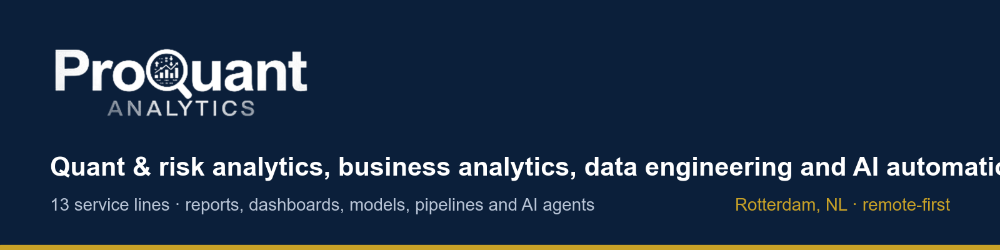

# ProQuant Analytics

**Quant & risk analytics, business analytics, data engineering and AI automation.** Rotterdam, NL · remote-first.

I turn financial and business data into decisions: independent validation of strategies and models, risk and investor reporting, automated management packs, the data pipelines underneath, and AI agents tested before they go live. Each project below shows the full package a client receives (report, one-page summary, presentation, Excel workbook and interactive dashboard) on synthetic demo data.

 

## Quant & Risk (01–10)

<table>
<tr>
<td width="33%" valign="top"> <b><a href="https://github.com/AbduWars/proquant-01-strategy-backtesting">01 · Strategy Backtesting & Validation</a></b> Independent evidence of whether a trading strategy's backtest is real, robust and likely to persist.</td>
<td width="33%" valign="top"> <b><a href="https://github.com/AbduWars/proquant-02-portfolio-risk">02 · Portfolio Risk & Performance</a></b> A holdings-based risk view: VaR, Expected Shortfall, stress tests and limit monitoring, refreshed every month.</td>
<td width="33%" valign="top"> <b><a href="https://github.com/AbduWars/proquant-03-investor-reporting">03 · Investor Reporting</a></b> A reconciled monthly investor pack: factsheet, tear sheet, attribution and commentary, checked before release.</td>
</tr>
<tr>
<td width="33%" valign="top"> <b><a href="https://github.com/AbduWars/proquant-04-credit-scoring">04 · Credit Scoring Model & Scorecard</a></b> An explainable retail credit scorecard with a profit-based cut-off, fairness testing and monitoring.</td>
<td width="33%" valign="top"> <b><a href="https://github.com/AbduWars/proquant-05-model-validation">05 · Independent Model Validation</a></b> An evidence-based second opinion on a credit-risk model, with a severity-rated findings log.</td>
<td width="33%" valign="top"> <b><a href="https://github.com/AbduWars/proquant-06-reporting-automation">06 · Financial Reporting Automation</a></b> A monthly report that checks its own data, drafts its commentary and holds itself when it is not safe to release.</td>
</tr>
<tr>
<td width="33%" valign="top"> <b><a href="https://github.com/AbduWars/proquant-07-management-pack">07 · Monthly Management Pack</a></b> The board pack from the trial balance: P&L vs budget, the reasons, cash, covenants and the year-end outlook.</td>
<td width="33%" valign="top"> <b><a href="https://github.com/AbduWars/proquant-08-transaction-cost-analysis">08 · Transaction Cost Analysis (TCA)</a></b> What trading really costs, where it is lost, who is responsible and how much could be saved.</td>
<td width="33%" valign="top"> <b><a href="https://github.com/AbduWars/proquant-09-fraud-detection">09 · Fraud & Anomaly Detection</a></b> What your fraud controls catch, what they miss, and where your analysts' hours should go.</td>
</tr>
<tr>
<td width="33%" valign="top"> <b><a href="https://github.com/AbduWars/proquant-10-data-quality-reconciliation">10 · Data Quality & Reconciliation</a></b> Is the data fit for use, and do the systems agree? Measured, matched and explained line by line.</td>
</tr>
</table>

## Business Analytics (11)

<table>
<tr>
<td width="33%" valign="top"> <b><a href="https://github.com/AbduWars/proquant-11-business-analytics">11 · Business Analytics</a></b> Where the business makes money, where it loses it, and what to do next. For any industry.</td>
</tr>
</table>

## Data Engineering (12)

<table>
<tr>
<td width="33%" valign="top"> <b><a href="https://github.com/AbduWars/proquant-12-data-engineering">12 · Data Engineering (ETL/ELT & Warehouse)</a></b> One trusted foundation for a business's data: collected, contract-checked, modelled and served every night.</td>
</tr>
</table>

## AI Automation (13)

<table>
<tr>
<td width="33%" valign="top"> <b><a href="https://github.com/AbduWars/proquant-13-ai-automation-agents">13 · AI Automation & Agents</a></b> Which manual work an AI agent can take over safely, measured on your own cases, and installed on your own platform.</td>
</tr>
</table>

## Every project includes

| File | For |
|---|---|
| Start page (`00_START_HERE.html`) | Everyone: one file, opens in any browser |
| PDF report | The specialist: findings with evidence |
| One-page summary | The decision-maker |
| PowerPoint presentation with speaker notes | The committee or board |
| Excel workbook with live formulas | The analyst |
| Methodology and handover note | Auditors and the owner |
| Interactive HTML dashboard | Whoever explores |

---

<b>ProQuant Analytics</b> · <a href="https://www.proquant-analytics.com">www.proquant-analytics.com</a> · <a href="mailto:info@proquantanalytics.com">info@proquantanalytics.com</a>

